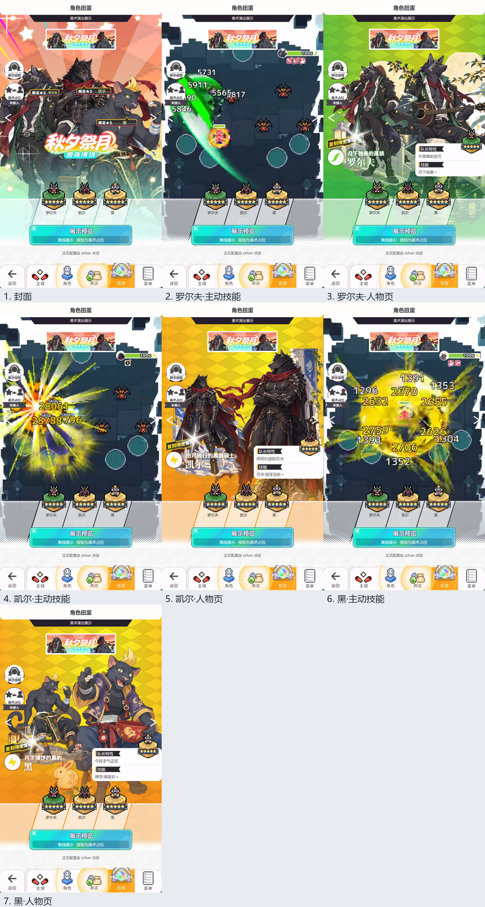

# 秋夕祭月·兽夜博饼

完整离线演出、美术原件和场景行片段；未接入游戏。

展示角色：罗尔夫（149986）、凯尔（139990）、黑（139991）。名单不表示正式 UP。

采用 full-offline-02 对应的姓名、称号和限定牌修正版。三份 replay 仅包含已选中的初始球坐标调整，地形与供体字节一致但使用独立资源名。凯尔录制链角色表包含 tag_paradox_kyle，而对应文本数据的该列为空；本包不覆盖角色表，作者接入时需核对当前有效版本。罗尔夫及凯尔外沿效果仍需检查实际按钮遮挡。



从上级目录生成完整 HTML：

```sh
node --max-old-space-size=192 build-preview.cjs autumn-beast-dice autumn-beast-dice/review.html
```

详见[公共交付说明](../README.md)的资源和五表接入方法。完整性记录见 [DELIVERY.json](../DELIVERY.json)。
