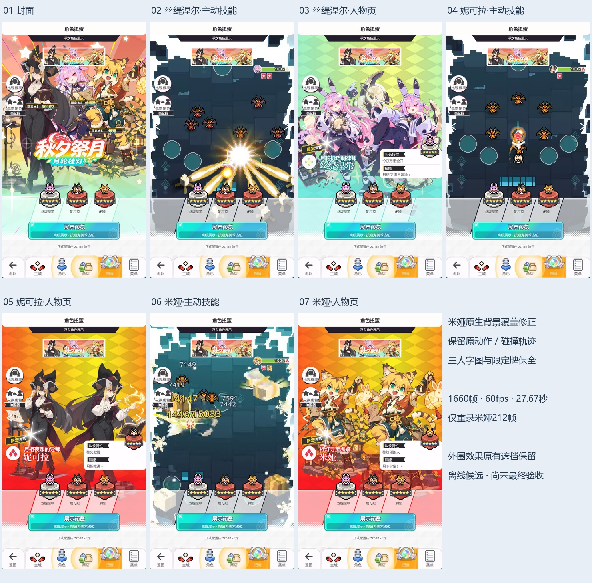

# 秋夕祭月·月轮桂灯

完整离线演出、美术原件和场景行片段；未接入游戏。

展示角色：丝缇涅尔（159995）、妮可拉（119991）、米娅（119992）。名单不表示正式 UP。

采用 complete-03-mia-background，包含修正姓名/称号/限定牌后的美术和米娅背景修复。米娅的 212 帧原生录制来自背景修正版；背景上移保留了原轨迹及技能窗口。丝缇涅尔下方乐器、外沿光束以及米娅左侧和周边效果仍可能接近或被真实 UI 遮挡，未作手机验收。



从上级目录生成完整 HTML：

```sh
node --max-old-space-size=192 build-preview.cjs autumn-moon-laurel autumn-moon-laurel/review.html
```

详见[公共交付说明](../README.md)的资源和五表接入方法。完整性记录见 [DELIVERY.json](../DELIVERY.json)。
