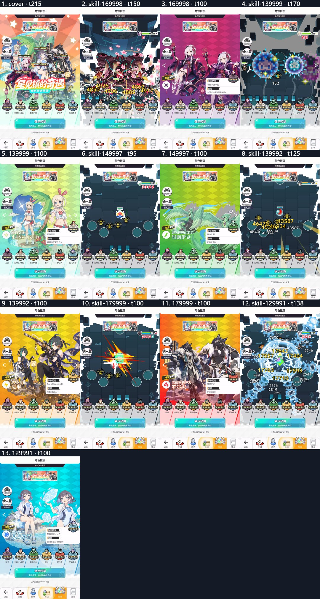

# 星见镇的奇遇

完整离线演出、美术原件和场景行片段；未接入游戏。

展示角色：拉芙（169998）、史黛拉（夏日）（139999）、墨斯伊克（149997）、夏琳（139992）、罗尔夫（179999）、见岛勇希（129991）。名单不表示正式 UP。

采用 complete-v2 对应的六人美术。姓名、称号和限定牌使用最后修正的位图；拉芙与史黛拉采用最新选中的构图录制。部分外沿效果仍可能触及实际 UI，需目标客户端检查。



从上级目录生成完整 HTML：

```sh
node --max-old-space-size=192 build-preview.cjs starview-encounter starview-encounter/review.html
```

详见[公共交付说明](../README.md)的资源和五表接入方法。完整性记录见 [DELIVERY.json](../DELIVERY.json)。
